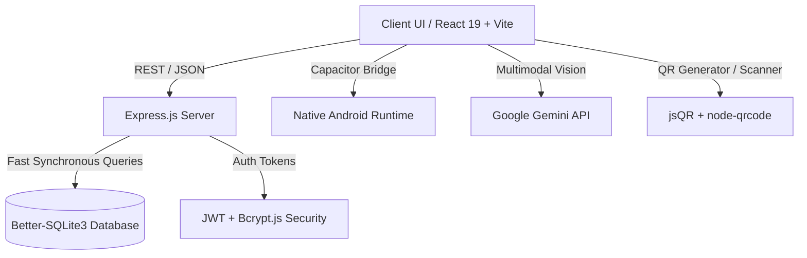

# Foodzyra 🍲 | AI-Powered Real-Time Surplus Food Redistribution Platform

[](https://react.dev/)
[](https://www.typescriptlang.org/)
[](https://vitejs.dev/)
[](https://tailwindcss.com/)
[](https://capacitorjs.com/)
[](https://github.com/WiseLibs/better-sqlite3)
[](https://ai.google.dev/)

> **Foodzyra** bridges the gap between commercial surplus food generators (restaurants, bakeries, supermarkets) and recipients (conscious consumers and verified hunger-relief NGOs) to eliminate food waste and fight food insecurity.

---

## 🌟 Key Capabilities & Architectural Highlights

### 1. 🏢 Multi-Stakeholder Ecosystem
- **Businesses & Food Donors**: Create instant listings for surplus meals, bakery items, or bulk ingredients with shelf-life timers, dynamic discounted pricing, and quantity controls.
- **Conscious Consumers**: Discover hyper-local, heavily discounted mystery bags and surplus gourmet meals using real-time geolocation filtering.
- **Verified Hunger-Relief NGOs**: Claim bulk donations prioritized for zero-cost distribution to shelters, old-age homes, and community kitchens.
- **Admin Oversight**: Real-time platform analytics, environmental impact metrics (CO₂ emissions prevented, meals rescued, water saved), and audit logging.

### 2. 🧠 AI Food Vision (Powered by Google Gemini 2.0)
- **Computer Vision Freshness & Shelf-Life Assessment**: Users and donors take photos of surplus food items to automatically detect dish type, estimate shelf-life window, calculate macronutrient profiles, and flag potential allergen risks.
- **Smart Cataloging**: Instant title, description, and category generation directly from visual inputs.

### 3. 📲 Frictionless Contactless QR Verification
- **Dynamic Verification Codes**: Each reservation generates a unique cryptographic QR token (`jsqr` / `qrcode`).
- **One-Tap Validation**: Store attendants or NGO volunteers scan recipient QR codes for zero-friction handoffs with instant database state synchronization.

### 4. 🗺️ Geolocation & Turn-by-Turn Routing
- **Proximity-Based Search**: Uses HTML5 Geolocation to rank nearby surplus food by distance (km/miles).
- **Navigation Integration**: Modal-based route guidance with turn-by-turn directions to the pickup location.

### 5. 📱 Hybrid Cross-Platform (Web + Android Native)
- Fully responsive web application powered by React 19 + Tailwind CSS.
- First-class native Android build integration via **Capacitor 8** (`@capacitor/android`), providing native camera access, push notifications, and device sensors.

---

## 🏗️ Architecture & Tech Stack



- **Frontend**: React 19, TypeScript, Tailwind CSS v4, Lucide Icons, Canvas Confetti.
- **Backend API**: Node.js, Express 5, TypeScript (`tsx`).
- **Storage**: Better-SQLite3 with WAL (Write-Ahead Logging) mode for microsecond transactional persistence.
- **AI & Computer Vision**: `@google/genai` (Gemini 2.0 Flash Multimodal).
- **Mobile Engine**: `@capacitor/core`, `@capacitor/android`, `@capacitor/cli`.

---

## 🚀 Getting Started

### Prerequisites
- Node.js `>= 18.0.0`
- npm or pnpm
- (Optional for Android builds): Android Studio & Android SDK

### 1. Installation
```bash
git clone https://github.com/iamwarriorofmyuniverse-coder/foodzyra.git
cd foodzyra
npm install
```

### 2. Environment Configuration
Create a `.env` file in the root directory:
```env
PORT=5000
JWT_SECRET=your_super_secret_jwt_key
GEMINI_API_KEY=your_gemini_api_key_here
```

### 3. Running Locally
Start both the Express API server and the Vite development server:
```bash
# Terminal 1: Launch Express API Server
npm run server

# Terminal 2: Launch Vite Frontend
npm run dev
```
Open [http://localhost:5173](http://localhost:5173) in your browser.

---

## 📱 Native Android Build (Capacitor)

```bash
# 1. Build the production web assets
npm run build

# 2. Sync web assets with the Android native project
npx cap sync android

# 3. Open in Android Studio to build APK or run on emulator
npx cap open android
```

---

## 🔒 Security & Data Integrity
- Passwords salted and hashed with `bcryptjs`.
- Stateless role-based access control (RBAC) enforced via signed JSON Web Tokens (`jsonwebtoken`).
- Schema validation via `zod` for incoming API payloads.
- Strict database constraints to prevent double-reservation of limited surplus portions.

---

## 📄 License
This project is open-source under the [MIT License](LICENSE).
